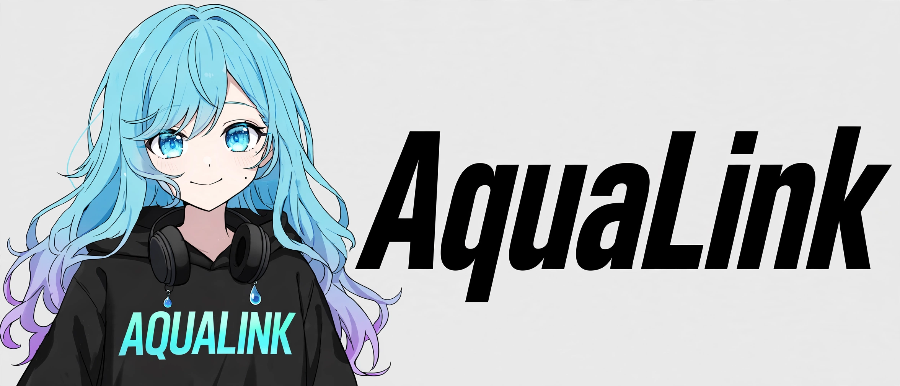

<div align="center">



[](https://www.npmjs.com/package/aqualink)
[](https://www.npmjs.com/package/aqualink)
[](https://github.com/ToddyTheNoobDud/AquaLink/stargazers)
[](https://discord.gg/K4CVv84VBC)

[Examples](https://github.com/ToddyTheNoobDud/AquaLink/tree/v4-ts-rewrite/examples) · [Example bot](https://github.com/ToddyTheNoobDud/Kenium-Music) · [Support](https://discord.gg/K4CVv84VBC)

</div>

# AquaLink v4

A Lavalink v4 and NodeLink client for Discord bots, written in TypeScript.
Players, queues and filters work out of the box. When you need different
behavior, replace the parts you want from your bot code. No fork needed.

## Features

- Track loading, searches and playlists, with typed Lavalink and NodeLink payloads.
- Playback controls, queue progression, looping and shuffle.
- Optional lazy queues, replaceable queue storage and playback without a queue.
- Equalizer, bassboost, nightcore, vaporwave, karaoke, 8D and other filter helpers.
- Multiple nodes, load balancing and node reconnection with configurable retries.
- Typed events, raw server events and custom ops for your own handlers.
- Optional session resuming, player persistence and replaceable built-in autoplay.
- ESM and CommonJS exports, TypeScript declarations and a replaceable stdout logger.

## Installation

Use Node.js **22.19+** or Bun **1.4.0+**, a Lavalink v4 or NodeLink server, and
your preferred Discord library. Your bot needs the Guilds and GuildVoiceStates intents.

| Package manager | Install v4 |
| --- | --- |
| npm | `npm install aqualink@latest` |
| Bun | `bun add aqualink@latest` |
| pnpm | `pnpm add aqualink@latest` |
| Yarn | `yarn add aqualink@latest` |

```ts
import { Aqua } from 'aqualink'
```

CommonJS works too: `const { Aqua } = require('aqualink')`.

Typings and method examples are included for autocomplete.
You don't need a separate `@types/aqualink` package. :P.

## Connect your bot

With an existing Seyfert client, create Aqua in `aqua.ts`:

```ts
import { Aqua } from 'aqualink'

export const aqua = new Aqua(client, [
  {
    name: 'main',
    host: '127.0.0.1',
    port: 2333,
    password: process.env.NODE_PASSWORD!,
    ssl: false
  }
], {
  lazyloadPlayer: true,
  send: async (packet) => {
    const shardId = client.gateway.calculateShardId(packet.d.guild_id)
    await client.gateway.send(shardId, packet)
  }
})

aqua.on('nodeReady', (node) => {
  console.log(`${node.name} is ready`)
})

aqua.on('nodeError', (node, error) => {
  console.error(node.name, error)
})
```

Forward voice packets in `src/events/raw.ts`:

```ts
import { createEvent } from 'seyfert'
import { aqua } from '../../aqua.ts'

export default createEvent({
  data: { name: 'raw' },
  async run(packet) {
    if (packet.t === 'VOICE_STATE_UPDATE' || packet.t === 'VOICE_SERVER_UPDATE') {
      await aqua.updateVoiceState(packet)
    }
  }
})
```

Initialize it in `src/events/botReady.ts`, after Discord supplies the bot ID:

```ts
import { createEvent } from 'seyfert'
import { aqua } from '../../aqua.ts'

export default createEvent({
  data: { name: 'botReady', once: true },
  async run(user) {
    await aqua.init(user.id)
  }
})
```

Adjust the imports to your bot's layout. If you already handle these events,
add the AquaLink calls there.

For another Discord library, provide its gateway sender through `send` and forward
the same two incoming voice packets to `aqua.updateVoiceState()`. Keep the original
`{ t, d }` payload; AquaLink filters voice states by the bot's user ID.

`init(botId)` opens the node connections. Wait for `nodeReady` before creating
players. Node hosts have no URL scheme; set `ssl: true` for HTTPS/WSS.

## Search and play

Inside your command, use the guild ID and the user's voice channel ID:

```ts
const result = await aqua.resolve({
  query: 'artist song',
  source: 'ytsearch',
  requester: { id: userId }
})

if (result.exception) {
  throw new Error(result.exception.message ?? 'Track loading failed')
}

const track = result.tracks[0]
if (track) {
  const player = await aqua.createConnection({
    guildId,
    voiceChannel,
    textChannel
  })
  await player.play(track)
}
```

URLs use the same method. Search sources depend on what's enabled on your node.
For playlists, add `result.tracks` to `player.queue` and call `await player.play()`
when idle. `result.playlistInfo` contains the playlist metadata.

`play(track)` starts immediately when idle, or adds the track behind current
playback. `play()` starts the first waiting track. To replace current while
keeping the queue, use `play(track, { noReplace: false })`.

### Controls and filters

```ts
await player.pause(true)
await player.pause(false)
await player.seek(30_000)
await player.setVolume(80)
await player.filters.setNightcore(true)

player.setLoop('queue')
player.shuffle()

await player.skip()
await player.stop()
await player.destroy()
```

Await playback controls, filter updates and destruction.

| Operation | Behavior |
| --- | --- |
| `stop()` / `skip()` | Ends current; its `stopped` event advances the queue or autoplay, or emits `queueEnd` |
| `destroy()` | Leaves voice, clears the queue and removes the player |
| Track finishes, fails to load or is stopped | The default handler starts the next waiting track, or tries autoplay when enabled |
| Bot is kicked from voice | Destroys the player and queue; the next explicit connection creates a new player |

`player.current` holds the playing track; `player.queue` holds the next tracks.
See the [queue examples](https://github.com/ToddyTheNoobDud/AquaLink/blob/v4-ts-rewrite/examples/README.md#replace-queue-storage)
for lazy queues, custom storage and playback without a queue.

`stop()` resolves when the node accepts the stop. Its end event performs
progression and clears `current`. To end playback entirely, disable autoplay,
clear any waiting queue and then call `stop()`:

```ts
player.setAutoplay(false)
if (player.hasQueue) {
  player.queue.clear()
}
await player.stop()
```

## Events

Listen on Aqua for all players, or on a Player for one guild:

```ts
aqua.on('trackStart', (player, track) => {
  console.log(player.guildId, track?.title)
})

player.on('trackEnd', (track, reason) => {
  console.log(track?.title, reason)
})

player.on('event', (payload) => {
  console.log(payload.type)
})

aqua.on('nodeCustomOp', (node, op, payload) => {
  console.log(node.name, op, payload)
})
```

Aqua's track events receive the player first. To listen for raw player events,
use `event` or the protocol name, such as `player.on('TrackEndEvent', ...)`.

See [event types](https://github.com/ToddyTheNoobDud/AquaLink/blob/v4-ts-rewrite/src/shared/Events.ts)
for listener arguments and the [custom event example](https://github.com/ToddyTheNoobDud/AquaLink/blob/v4-ts-rewrite/examples/events.ts)
for adding your own behavior.

## Make it yours

For a complete bot, see [Kenium-Music](https://github.com/ToddyTheNoobDud/Kenium-Music).
It uses AquaLink with Seyfert.

The [examples guide](https://github.com/ToddyTheNoobDud/AquaLink/blob/v4-ts-rewrite/examples/README.md)
covers custom players, queues, events, filters and more. Start with
[setup.ts](https://github.com/ToddyTheNoobDud/AquaLink/blob/v4-ts-rewrite/examples/setup.ts)
and copy the overrides you need.

Register your subclasses through `options.structures` before creating players or
nodes. Call `super` to keep the default behavior.

## Configuration

| Option | Default | Purpose |
| --- | --- | --- |
| `defaultSearchPlatform` | `'ytsearch'` | Search prefix for plain queries |
| `lazyloadPlayer` | `false` | Create waiting storage on demand |
| `loadBalancer` | `'leastLoad'` | Choose a node by load, or use `'random'` |
| `nodeConfigs.maxRetries` | `10` | Maximum node reconnect attempts |
| `nodeConfigs.infiniteReconnects` | `false` | Keep reconnecting past that limit |
| `autoResume` | `false` | Request session resuming and restore players when the session expires |
| `leaveOnEnd` | `false` | Destroy the player when playback and its waiting queue end |
| `logging.level` | `'info'` | Built-in log threshold; `'silent'` disables it |

Pass your own `logger` to use your bot's logging setup. The
[logger example](https://github.com/ToddyTheNoobDud/AquaLink/blob/v4-ts-rewrite/examples/logger.ts)
uses Seyfert.

Enable autoplay with `player.setAutoplay(true)`. It uses YouTube radio mixes,
Spotify recommendations or SoundCloud artist searches, depending on the track
and the sources enabled on your node. Autoplay is off by default.

To choose recommendations yourself, pass `options.autoplay` or override
`Player.getAutoplayTrack()`. See the
[autoplay example](https://github.com/ToddyTheNoobDud/AquaLink/blob/v4-ts-rewrite/examples/README.md#add-an-autoplay-policy).

Use `savePlayer(path?)` and `loadPlayers(path?)` to save and restore players.

All options and defaults are documented in the
[TypeScript types](https://github.com/ToddyTheNoobDud/AquaLink/blob/v4-ts-rewrite/src/types/shared.ts).

## REST and server APIs

Use `player.node.rest` or `aqua.getNode(name)?.rest` for direct requests.
The helpers cover player and session updates, track loading, lyrics, mixers and
other server endpoints. Your node must support the endpoint you're calling.

`makeRequest<T>(path, method?, body?)` returns parsed JSON or text, `null` for 204,
and `undefined` on failure. Use `request()` when you need the `Response` itself.

Protocol references: [Lavalink REST](https://lavalink.dev/api/rest),
[Lavalink WebSocket](https://lavalink.dev/api/websocket) and
[NodeLink REST](https://nodelink.js.org/docs/api/rest).

## Moving from v3

Some v3 calls and defaults have changed. Read the
[v4 breaking changes](https://github.com/ToddyTheNoobDud/AquaLink/blob/v4-ts-rewrite/Changelog.md)
before updating an existing bot.

## Support

Need help or found a bug? Join the [Discord server](https://discord.gg/K4CVv84VBC)
or [open an issue](https://github.com/ToddyTheNoobDud/AquaLink/issues).

## License

[WTFPL](https://github.com/ToddyTheNoobDud/AquaLink/blob/v4-ts-rewrite/LICENSE.md).
